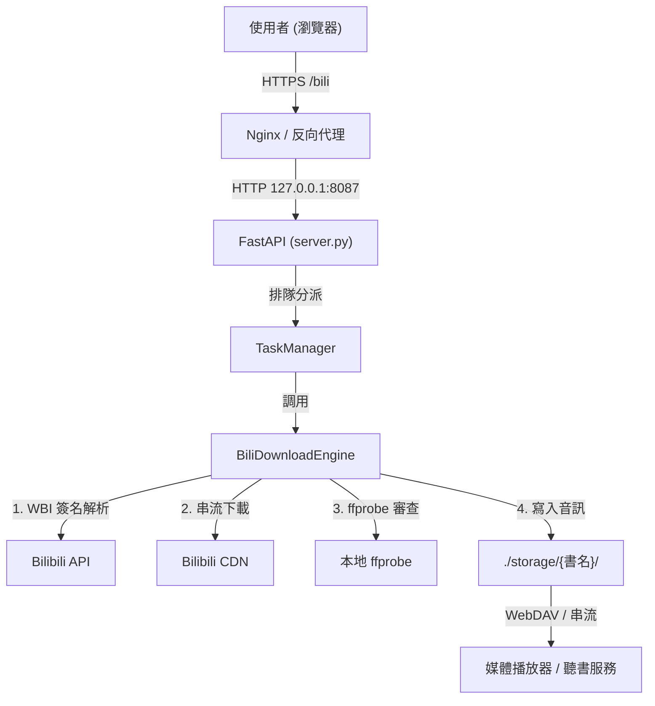

# 📘 Bilibili 遠端排隊音訊下載器 (bili-web) 維護交接手冊 (Handover Manual)

> **文件版本**：`v1.0.0`  
> **交接對象**：接手本專案之 AI Agent / 系統維護工程師  
> **最後更新日期**：`2026-10-12`  

---

## 📑 目錄
1. [專案背景與定位](#1-專案背景與定位)
2. [伺服器拓撲與部署資訊](#2-伺服器拓撲與部署資訊)
3. [帳號安全與認證資訊](#3-帳號安全與認證資訊)
4. [核心架構與代碼巡禮](#4-核心架構與代碼巡禮)
5. [資料流與儲存拓撲](#5-資料流與儲存拓撲)
6. [反向代理與網路架構](#6-反向代理與網路架構)
7. [運維命令速查 (Runbook)](#7-運維命令速查-runbook)
8. [常見故障排查 (Troubleshooting)](#8-常見故障排查-troubleshooting)

---

## 1. 專案背景與定位

本專案是一個專為 **Bilibili 長篇音訊、有聲小說、多 P 播客** 打造的遠端異步排隊下載器 Web GUI。

### 🌟 核心特色
1. **雙模式音質抓取**：
   - `64k`：針對有聲書/演講特化（約 36~64 kbps M4A），體積極小，音質清晰，節省伺服器與串流流量。
   - `best`：抓取最高可用 DASH 音訊串流。
2. **反風控與反爬蟲引擎**：
   - 內建 **WBI 動態簽名算法 (`WbiSigner`)**，定時拉取 B 站金鑰生成 `w_rid` 與 `wts`，徹底避開 B 站針對雲端 IP 的 `HTTP 412` 攔截。
   - 內建匿名設備指紋 (`buvid3`/`buvid4`) 自動獲取機制；亦支援使用者貼上個人大會員 Cookie 下載高碼率。
   - 具備 `min_delay ~ max_delay`（預設 5~15 秒）隨機抖動間隔，避免高頻請求觸發封鎖。
3. **4 重檔案完整性審查**：
   - 下載前/後調用 `ffprobe` 校驗時長、位元率（Bitrate < 35 kbps 判定無效）與檔案大小，損壞自動清理並重試，絕不留下 0-byte 殘留檔。
4. **全端無縫串聯**：
   - 下載完畢後檔案自動進入儲存庫，無縫對接 WebDAV、Jellyfin 或 Audiobookshelf 進行線上串流聽書。

---

## 2. 伺服器拓撲與部署資訊

| 項目 | 規格 / 設定值 | 備註 |
| :--- | :--- | :--- |
| **主機環境** | Linux (Ubuntu / Debian, x86_64 或 aarch64) | 支援一般 VPS 或 NAS |
| **部署方式** | Docker Compose 或 Systemd 守護程序 | 推薦使用 Docker |
| **服務根目錄** | `/srv/bili-web` 或 `./bilibili_web` | 依實際環境配置 |
| **Python 環境** | Python 3.12+ (內建或 Docker 容器內) | 需包含 `ffmpeg` |
| **預設服務埠** | `8087` | 外部可透過 Nginx/OpenResty 反向代理 |
| **訪問路徑** | `https://your-domain.com/bili` | 需支援 WebSocket (`/bili/ws`) |

---

## 3. 帳號安全與認證資訊

系統採用 FastAPI 內建的 `HTTPBasic` 進行全站認證（包含 API 與靜態頁面）。

### 🔑 登入憑證配置
憑證由環境變數或 `.env` 檔案控制：
* **帳號變數**：`ADMIN_USERNAME` (預設: `admin`)
* **密碼變數**：`ADMIN_PASSWORD` (請於部署時自訂安全密碼)

### ⚙️ 設定檔範例 (`.env`)
```bash
HOST=0.0.0.0
PORT=8087
ADMIN_USERNAME=admin
ADMIN_PASSWORD=your_secure_password_here
STORAGE_BASE_DIR=./storage
LOGS_DIR=./data/logs
HISTORY_FILE=./data/history.json
COOKIE_FILE=./data/cookie.txt
SECRET_KEY=your_secret_key_here
```

---

## 4. 核心架構與代碼巡禮

```
bilibili_web/
├── Dockerfile            # Docker 容器構建檔 (基於 python:3.12-slim + ffmpeg)
├── docker-compose.yml    # Docker Compose 一鍵啟動配置
├── requirements.txt      # Python 依賴清單
├── .env.example          # 環境變數範本
├── config.py             # Pydantic Settings 配置定義與讀取器
├── server.py             # FastAPI 核心應用、路由定義、Basic Auth 與 WebSocket
├── task_manager.py       # 異步任務佇列管理器、背景 Worker、歷史記錄與 WebSocket 廣播
├── bili_engine.py        # B 站底層下載引擎 (WBI 簽名、DASH 解析、音訊校驗、防風控)
├── bili-web.service      # Systemd 傳統守護程序設定範本
└── templates/
    └── index.html        # 單頁應用前端 (TailwindCSS + JetBrains Mono + WebSocket 即時連線)
```

---

## 5. 資料流與儲存拓撲



---

## 6. 反向代理與網路架構 (Nginx 範例)

```nginx
location ^~ /bili {
    proxy_pass http://127.0.0.1:8087; 
    proxy_set_header Host $host; 
    proxy_set_header X-Real-IP $remote_addr; 
    proxy_set_header X-Forwarded-For $proxy_add_x_forwarded_for; 
    proxy_set_header Upgrade $http_upgrade; 
    proxy_set_header Connection $http_connection; 
    proxy_set_header X-Forwarded-Proto $scheme; 
    proxy_http_version 1.1; 
    add_header Cache-Control no-cache; 
}
```

---

## 7. 運維命令速查 (Runbook)

### 🐳 Docker 模式 (推薦)
```bash
# 啟動服務
docker compose up -d

# 查看運行日誌
docker compose logs -f

# 重新構建並重啟
docker compose up -d --build
```

### ⚙️ 傳統 Systemd 模式
```bash
# 查看服務狀態
sudo systemctl status bili-web.service

# 重啟服務
sudo systemctl restart bili-web.service

# 查看日誌
sudo journalctl -u bili-web.service -f -n 50
```

---

## 8. 常見故障排查 (Troubleshooting)

### Q1: 訪問跳出 `401 Unauthorized`？
* **處理**：確認帳號密碼與 `.env` 或 `docker-compose.yml` 中的 `ADMIN_USERNAME` 與 `ADMIN_PASSWORD` 一致。

### Q2: 下載任務報錯 `Bilibili API 錯誤: -412`？
* **原因**：Bilibili 觸發了風控反爬攔截（請求頻率過高或 WBI 密鑰過期）。
* **處理**：
  1. 重啟服務強制刷新 WBI 密鑰：`docker compose restart` 或 `systemctl restart bili-web`。
  2. 到前端「帳號 Cookie」面板貼入個人 B 站 Cookie（含 `SESSDATA`）。
  3. 增加任務延遲時間（建單時將延遲調高至 15~30 秒）。
